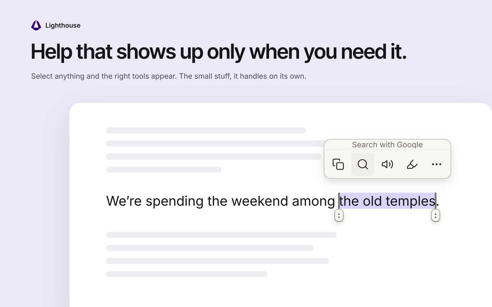
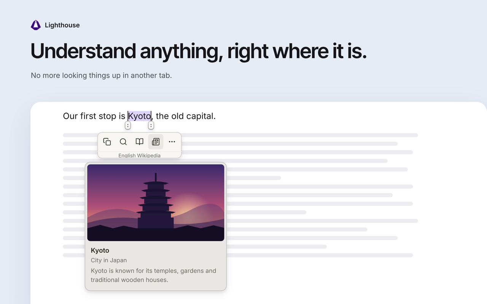
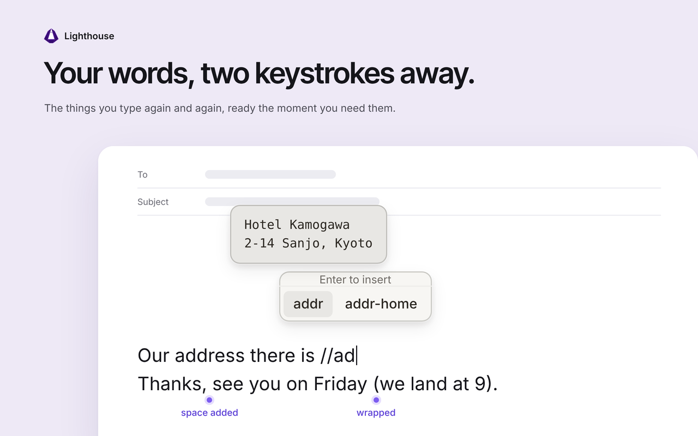
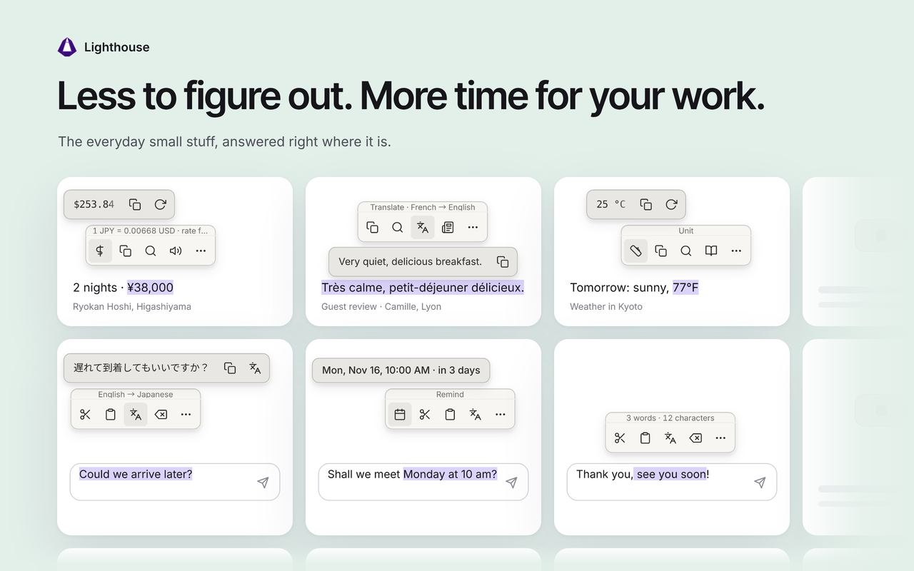
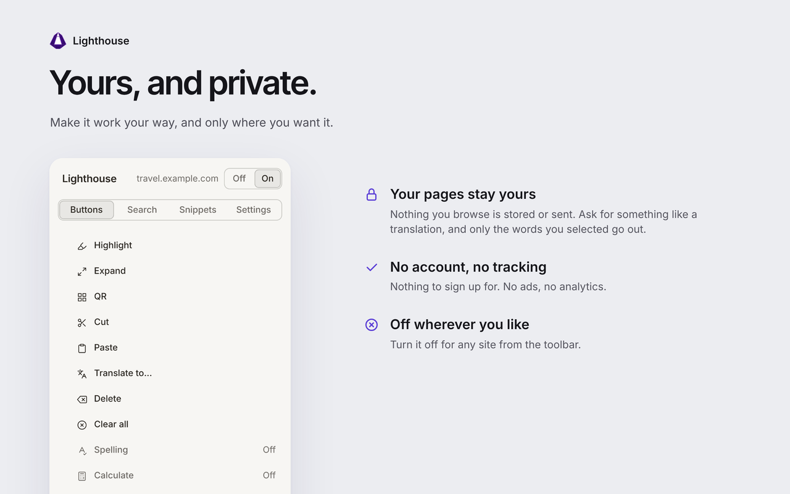

# Lighthouse

**Help that shows up only when you need it.**

Select anything on a page and the right tools appear: a translation, a definition, a converted price. Type anywhere and the small stuff takes care of itself. The rest of the time, you won't notice Lighthouse is there.

---

## When you read

Select a word, a name or a whole sentence and get what you need without leaving the page.

- **Look it up:** definitions, Wikipedia previews and search, with your choice of search engines
- **Translate:** text in another language, translated right over the words
- **Numbers in your terms:** prices in your currency, units in your system, sums worked out, dates turned into calendar reminders
- **Keep and share:** highlight what matters, have it read aloud, or send it to your phone with a QR code

## When you write

In any text box.

- **Snippets:** save phrases you type often and bring them back as you type
- **Send:** bring text from the page into the message you're writing
- **Translate what you write** into the language you need
- **Spelling and grammar** in many languages
- **Collect and paste:** gather bits from anywhere, then paste them all at once

## The small stuff, handled

Things you'd normally fix by hand, done before you notice. A few of them:

- Selecting part of a word selects the whole word
- Deleting leaves the spacing and punctuation right
- Typing a quote or bracket around a selection wraps it instead of replacing it
- Links you copy with Lighthouse come out without tracking codes
- Drag handles let you adjust a selection precisely

## Make it yours

Everything works out of the box. If you want to adjust it, reorder or hide buttons, add search engines, set your language and currency, or switch Lighthouse off for any site.

---

## Installation

Lighthouse isn't on the Chrome Web Store yet.

1. Download the latest zip from [Releases](https://github.com/kach17/Lighthouse/releases) and unzip it
2. Go to `chrome://extensions/` and turn on **Developer mode**
3. Click **Load unpacked** and select the unzipped folder, the one that contains `manifest.json`

Works on Chrome, Edge and Brave. Editors that draw their own text, like Google Docs, aren't supported.

---

## Privacy

Lighthouse runs on every page so it can appear when you select something, which is why Chrome asks for permission to read the pages you visit. It never stores or sends what you browse.

When a feature needs an outside service, Lighthouse sends only what that feature needs, and only when you point at or use it:

- **Translate and Define:** Google Translate and Wiktionary receive the words you selected
- **Wikipedia:** Wikipedia receives the term you selected
- **Currency:** Coinbase provides exchange rates; nothing you selected is sent
- **Spelling** (off by default): [LanguageTool](https://languagetool.org) receives the text you're checking and the sentence around it. See their [privacy policy](https://languagetool.org/legal/privacy).

Chrome also lists what else Lighthouse may do. Here is why:

- **Read the clipboard:** to show what Paste would insert
- **Site icons:** to show the icon next to a link, from your browser's own memory
- **Access to all sites** (optional): asked for only if you turn on link previews, to fetch the page behind the link you point at

Everything else happens on your device. Things you collect are forgotten when the browser closes. Snippets sync with your browser if you use sync. There is no account, no analytics and no ads.

---

## Contributing

Plain JavaScript, no bundler, no framework. See [DEVELOPER.md](./DEVELOPER.md).

---

## License

[MIT](./LICENSE)